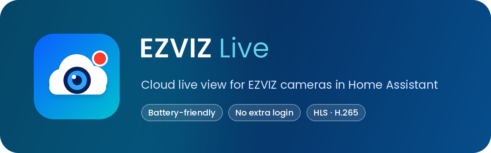

[](https://hacs.xyz/docs/faq/custom_repositories)
[](https://github.com/cceloto/ha-ezviz-live/releases)
[](https://github.com/cceloto/ha-ezviz-live/actions/workflows/validate.yml)
[](LICENSE)

**[English](#english)** | **[Português (Brasil)](#português-brasil)**

---

## English

Live video and audio from EZVIZ cameras **through the EZVIZ cloud**, the same way the EZVIZ app does it — including battery devices that sleep and have no RTSP, such as the DP2C smart peephole.

> [!WARNING]
> Early beta (`0.0.x`). Only the **EZVIZ DP2C** has been tested so far. Unofficial project, not affiliated with EZVIZ or Hikvision.

### Features

- 📹 Live view with audio in the native camera card, the more-info dialog and the Home Assistant mobile app.
- 🔋 Battery friendly: the device is woken **only while someone is watching**, and the session closes about 35 s after the last viewer leaves.
- 🖼️ Thumbnails never wake the device: they show the last frame of the previous session or, before that, the last motion picture from the EZVIZ integration.
- 🔑 No extra login: reuses the session of the core **EZVIZ** integration. No password is asked for or stored.
- 🧩 The camera joins the existing EZVIZ device (same area, same device page).
- 🛠️ Diagnostics download with masked serials, for bug reports.

### How it works

```
EZVIZ cloud ──(VTM → VTDU, encrypted)──▶ ezviz_live ──MPEG-PS──▶ HA stream ──HLS──▶ dashboard / app
                                              ▲
                     session borrowed from the core EZVIZ integration
```

The integration speaks the EZVIZ stream-server protocol (VTM/VTDU), decrypts the media and hands an MPEG-PS feed to Home Assistant's built-in `stream` component through a local relay on `127.0.0.1`. Home Assistant then serves it as HLS. Video is copied, never transcoded, so it runs fine on a Raspberry Pi 4. Protocol details are in [docs/protocol.md](docs/protocol.md).

### Requirements

- Home Assistant **2026.10** or newer.
- The core **[EZVIZ](https://www.home-assistant.io/integrations/ezviz/)** integration set up with your **cloud account** (two-factor authentication must be off, as the core integration requires).
- The device must open live view in the EZVIZ app.

### Installation

#### HACS (recommended)

[](https://my.home-assistant.io/redirect/hacs_repository/?owner=cceloto&repository=ha-ezviz-live&category=integration)

1. HACS → ⋮ → **Custom repositories** → add `https://github.com/cceloto/ha-ezviz-live`, type **Integration**.
2. Search for **EZVIZ Live** and download it.
3. Restart Home Assistant.

#### Manual

1. Copy `custom_components/ezviz_live` into `<config>/custom_components/ezviz_live`.
2. Restart Home Assistant.

### Configuration

[](https://my.home-assistant.io/redirect/config_flow_start/?domain=ezviz_live)

**Settings → Devices & services → Add integration → EZVIZ Live**, then pick the EZVIZ account. One camera entity is created per live-capable channel, named after the device (e.g. `camera.front_door_live`).

#### Options

| Option | Default | Description |
|---|---|---|
| Quality | Main stream | Main (highest resolution) or sub stream (lighter). |
| Allow WebRTC (go2rtc) | Off | Many EZVIZ cameras send **H.265**. Off: HLS only, which works everywhere. On: go2rtc tries WebRTC, lower latency, but H.265 only shows in browsers that support it. |

### Usage

Use any camera card. To save battery, prefer `camera_view: auto`: the card shows the thumbnail and live view starts only when you open it.

```yaml
type: picture-entity
entity: camera.front_door_live
camera_view: auto
```

> [!CAUTION]
> `camera_view: live` starts the stream every time the dashboard is open, which keeps a battery device awake.

Expect the first image about **10–12 s** after opening: about 3 s for the device to wake up, plus the time HLS needs to build its first segment.

### Compatibility

| Case | Status |
|---|---|
| Battery devices that sleep (DP2C) | ✅ tested |
| Single-channel cameras, with or without RTSP | 🟡 expected to work, untested |
| H.264 and H.265 | ✅ both pass through HLS |
| Image encryption ("verification code") on | 🧪 experimental: add the camera to the core EZVIZ integration with its verification code |
| Multi-channel devices (NVR/DVR, base stations) | 🧪 experimental: one entity per channel |
| Stream servers that require TLS | ❌ not supported yet |
| End-to-end encryption (E2EE) | ❌ not possible without the device key |

Tried it with another model? Please open a **[device report](https://github.com/cceloto/ha-ezviz-live/issues/new?template=device_report.yml)** — it is the fastest way to grow this table.

### Troubleshooting

- **Entity attributes**: `live_state` (`idle`, `opening`, `streaming`), `viewers`, `last_open_seconds`, `last_error`.
- **Repairs**: a repair issue tells you when a device has image encryption on and no verification code.
- **Debug log**:
  ```yaml
  logger:
    logs:
      custom_components.ezviz_live: debug
  ```
- **Diagnostics**: Settings → Devices & services → EZVIZ Live → ⋮ → Download diagnostics.

| `last_error` contains | Meaning |
|---|---|
| `VTDU refused the stream: 6001` / `5569` | Request rejected by the stream server (authentication). Please report it. |
| `ezviz_not_loaded` | The core EZVIZ integration is not loaded (restarting, offline, or needs re-authentication). |
| `verification code` | Image encryption is on; see Compatibility. |

### Development

- Tests: `pip install -r requirements_test.txt && pytest`.
- Branches: work goes into **`develop`** through pull requests; `main` only receives releases from `develop`.
- Versioning: [Semantic Versioning](https://semver.org/). `0.x.y` releases may change behavior between minor versions. See [CHANGELOG.md](CHANGELOG.md).

### Disclaimer

This is an unofficial, independent interoperability project for personal use. It is not affiliated with, endorsed by or supported by EZVIZ or Hikvision. "EZVIZ" is a trademark of its owner. The cloud protocol may change at any time and break this integration. Use at your own risk and within the EZVIZ terms of service.

### License

[MIT](LICENSE)

---

## Português (Brasil)

Vídeo e áudio ao vivo de câmeras EZVIZ **pela nuvem EZVIZ**, do mesmo jeito que o app EZVIZ faz, inclusive aparelhos a bateria que dormem e não têm RTSP, como o olho mágico DP2C.

> [!WARNING]
> Beta inicial (`0.0.x`). Por enquanto só o **EZVIZ DP2C** foi testado. Projeto não oficial, sem vínculo com a EZVIZ ou a Hikvision.

### Recursos

- 📹 Ao vivo com áudio no cartão de câmera nativo, no diálogo de detalhes e no app do Home Assistant.
- 🔋 Poupa bateria: o aparelho só acorda **enquanto alguém está assistindo**, e a sessão fecha uns 35 s depois que o último sai.
- 🖼️ A miniatura nunca acorda o aparelho: mostra o último quadro da sessão anterior ou, antes disso, a foto do último movimento da integração EZVIZ.
- 🔑 Sem login extra: reaproveita a sessão da integração **EZVIZ** nativa. Nenhuma senha é pedida ou guardada.
- 🧩 A câmera entra no aparelho EZVIZ que já existe (mesma área, mesma página).
- 🛠️ Diagnóstico para download com serial mascarado, para relatar problemas.

### Como funciona

```
nuvem EZVIZ ──(VTM → VTDU, cifrado)──▶ ezviz_live ──MPEG-PS──▶ stream do HA ──HLS──▶ painel / app
                                              ▲
                    sessão emprestada da integração EZVIZ nativa
```

A integração fala o protocolo dos servidores de vídeo da EZVIZ (VTM/VTDU), decifra a mídia e entrega um fluxo MPEG-PS ao componente `stream` do Home Assistant por um relay local em `127.0.0.1`. O Home Assistant serve isso como HLS. O vídeo é copiado, nunca recodificado, e roda bem num Raspberry Pi 4. Detalhes do protocolo em [docs/protocol.md](docs/protocol.md).

### Requisitos

- Home Assistant **2026.10** ou mais novo.
- A integração **[EZVIZ](https://www.home-assistant.io/integrations/ezviz/)** nativa configurada com a sua **conta na nuvem** (autenticação em duas etapas desligada, como a integração nativa exige).
- O aparelho precisa abrir o ao vivo no app EZVIZ.

### Instalação

#### HACS (recomendado)

[](https://my.home-assistant.io/redirect/hacs_repository/?owner=cceloto&repository=ha-ezviz-live&category=integration)

1. HACS → ⋮ → **Repositórios personalizados** → adicione `https://github.com/cceloto/ha-ezviz-live`, tipo **Integração**.
2. Procure **EZVIZ Live** e baixe.
3. Reinicie o Home Assistant.

#### Manual

1. Copie `custom_components/ezviz_live` para `<config>/custom_components/ezviz_live`.
2. Reinicie o Home Assistant.

### Configuração

[](https://my.home-assistant.io/redirect/config_flow_start/?domain=ezviz_live)

**Configurações → Dispositivos e serviços → Adicionar integração → EZVIZ Live**, e escolha a conta EZVIZ. É criada uma câmera por canal com ao vivo, com o nome do aparelho (ex.: `camera.porta_ao_vivo`).

#### Opções

| Opção | Padrão | Descrição |
|---|---|---|
| Qualidade | Principal | Principal (maior resolução) ou secundário (mais leve). |
| Permitir WebRTC (go2rtc) | Desligado | Muitas câmeras EZVIZ mandam **H.265**. Desligado: só HLS, que funciona em todo lugar. Ligado: o go2rtc tenta WebRTC, com menos atraso, mas H.265 só aparece em navegadores compatíveis. |

### Uso

Qualquer cartão de câmera serve. Para poupar bateria, prefira `camera_view: auto`: o cartão mostra a miniatura e o ao vivo só começa quando você abre.

```yaml
type: picture-entity
entity: camera.porta_ao_vivo
camera_view: auto
```

> [!CAUTION]
> `camera_view: live` inicia o stream sempre que o painel está aberto, o que mantém um aparelho a bateria acordado.

A primeira imagem aparece uns **10–12 s** depois de abrir: cerca de 3 s para o aparelho acordar, mais o tempo que o HLS leva para montar o primeiro segmento.

### Compatibilidade

| Caso | Situação |
|---|---|
| Aparelhos a bateria que dormem (DP2C) | ✅ testado |
| Câmeras de um canal, com ou sem RTSP | 🟡 deve funcionar, não testado |
| H.264 e H.265 | ✅ os dois passam pelo HLS |
| Criptografia de imagem ("código de verificação") ligada | 🧪 experimental: adicione a câmera na integração EZVIZ nativa com o código de verificação |
| Aparelhos com vários canais (NVR/DVR, bases) | 🧪 experimental: uma entidade por canal |
| Servidores de vídeo que exigem TLS | ❌ ainda não suportado |
| Criptografia ponta a ponta (E2EE) | ❌ impossível sem a chave do aparelho |

Testou com outro modelo? Abra um **[relato de aparelho](https://github.com/cceloto/ha-ezviz-live/issues/new?template=device_report.yml)**: é o jeito mais rápido de ampliar esta tabela.

### Solução de problemas

- **Atributos da entidade**: `live_state` (`idle`, `opening`, `streaming`), `viewers`, `last_open_seconds`, `last_error`.
- **Reparos**: um aviso aparece quando um aparelho está com criptografia de imagem ligada e sem código de verificação.
- **Log de depuração**:
  ```yaml
  logger:
    logs:
      custom_components.ezviz_live: debug
  ```
- **Diagnóstico**: Configurações → Dispositivos e serviços → EZVIZ Live → ⋮ → Baixar diagnóstico.

| `last_error` contém | Significado |
|---|---|
| `VTDU refused the stream: 6001` / `5569` | Pedido recusado pelo servidor de vídeo (autenticação). Por favor, relate. |
| `ezviz_not_loaded` | A integração EZVIZ nativa não está carregada (reiniciando, sem internet ou pedindo nova autenticação). |
| `verification code` | Criptografia de imagem ligada; veja Compatibilidade. |

### Desenvolvimento

- Testes: `pip install -r requirements_test.txt && pytest`.
- Branches: o trabalho entra na **`develop`** por pull request; a `main` só recebe versões vindas da `develop`.
- Versões: [Semantic Versioning](https://semver.org/lang/pt-BR/). Versões `0.x.y` podem mudar de comportamento entre versões menores. Veja o [CHANGELOG.md](CHANGELOG.md).

### Aviso

Projeto independente e não oficial de interoperabilidade, para uso pessoal. Não tem vínculo, aprovação nem suporte da EZVIZ ou da Hikvision. "EZVIZ" é marca do seu titular. O protocolo da nuvem pode mudar a qualquer momento e quebrar esta integração. Use por sua conta e risco e dentro dos termos de uso da EZVIZ.

### Licença

[MIT](LICENSE)
